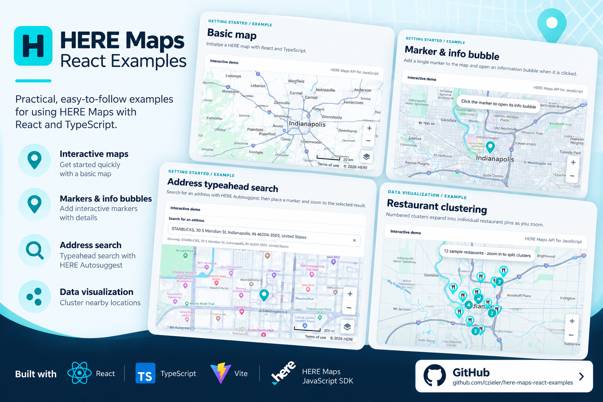

# HERE Maps + React Examples

A collection of working, focused examples of integrating HERE Maps with React, TypeScript, and Vite.

## Examples

| Example | Demonstrates |
| --- | --- |
| **Basic map** | HERE Maps JavaScript SDK initialization, controls, resize handling, and cleanup |
| **Marker & info bubble** | A custom teal marker with a clickable information bubble |
| **Address typeahead search** | HERE Autosuggest and Lookup APIs, keyboard-friendly suggestions, map centering, and a clickable marker |
| **Restaurant clustering** | A static list of 12 sample restaurants, custom restaurant pins, cluster counts, and zoom interactions |
| **Directions & route card** | HERE Routing API v8, multiple stops, flexible polyline rendering, and route summary |

These are **live examples**. There are no stored API responses or mock-data modes. Opening maps and using search or routing may consume API quota. Restaurant clustering uses a static list of 12 sample restaurants and makes no restaurant-data API requests.

## Setup

**Requirements:** Node.js 22.6+ and a HERE API key with access to Maps, Geocoding & Search, and Routing APIs.

```sh
npm install
cp .env.example .env.local
```

On Windows, copy `.env.example` to `.env.local` manually or run `copy .env.example .env.local` in Command Prompt.

Edit `.env.local`:

```dotenv
VITE_HERE_API_KEY=your_here_api_key
```

Then run:

```sh
npm run dev
```

HERE's scoped npm registry is configured in `.npmrc` for the JavaScript SDK. See [HERE's Vite guide](https://docs.here.com/maps-api-for-js/docs/vite-bundling).

**Security:** `.env.local` is gitignored. `VITE_` variables are embedded in the browser bundle; a client-side HERE API key is **not secret**. Restrict your key to appropriate allowed origins/services and review your usage limits before publishing a live demo. Never commit unrestricted credentials.

## Code organization

- `src/examples/basic/` — basic map
- `src/examples/marker/` — marker popup and address search
- `src/examples/clustering/` — static restaurant sample data, transformation, and clustering
- `src/examples/directions/` — live routing, response transformation, and route rendering
- `src/shared/maps/` — shared HERE map lifecycle, layout, and marker utilities
- `src/docs/examples.ts` — sidebar example descriptions and illustrative code excerpts
- `tests/` — pure transformation tests using inline test responses (not API caches)

Examples intentionally keep their SDK interactions visible to make them easier to learn from. Shared infrastructure is limited to repeatable map setup and marker styling.

## Validation

```sh
npm test
npm run lint
npm run build
```

These commands do not make live service calls. To verify real API functionality, run the app with your key and exercise each example in the browser.
